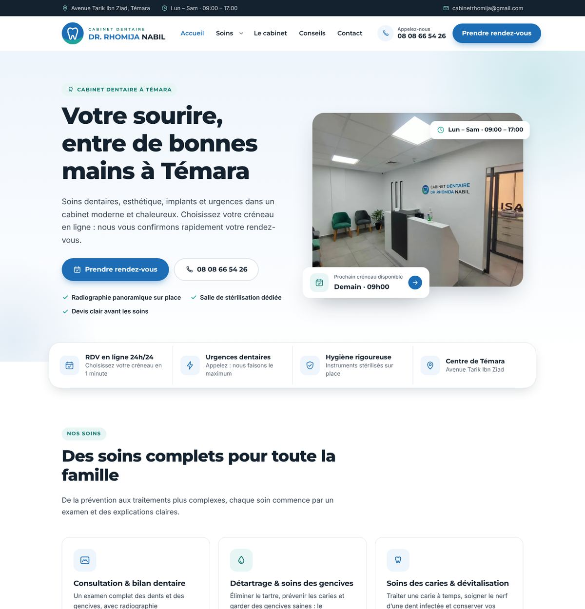
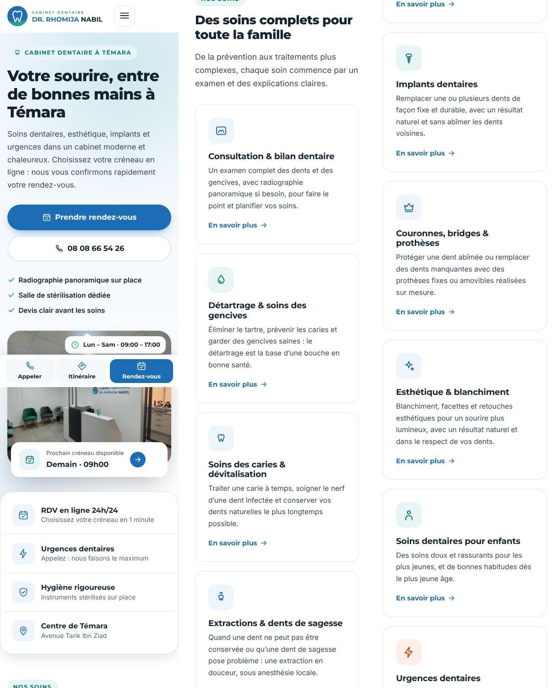
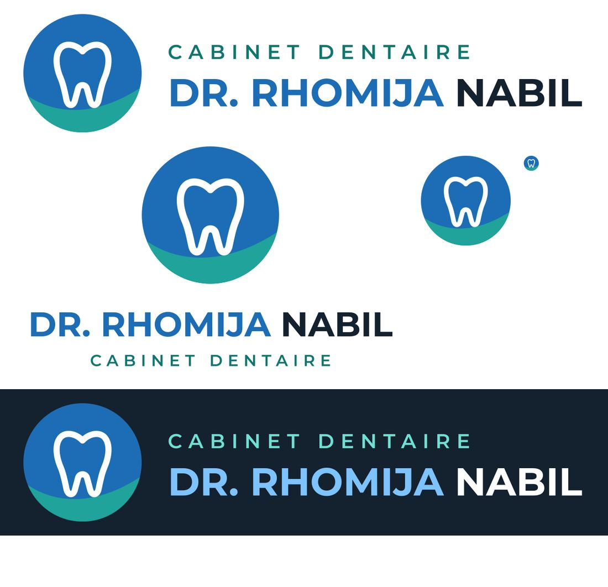
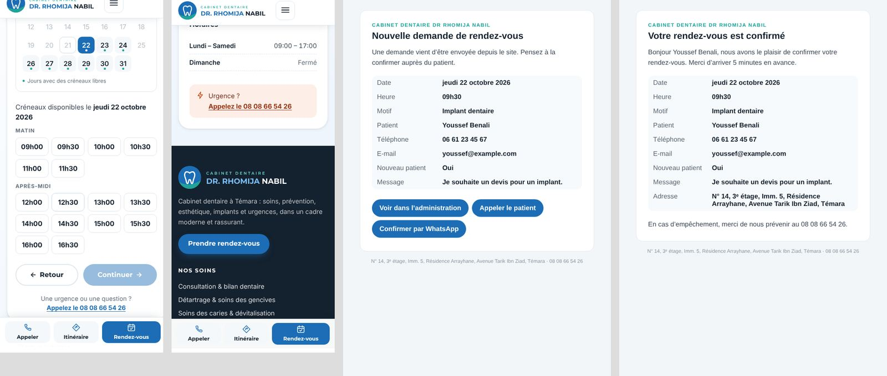
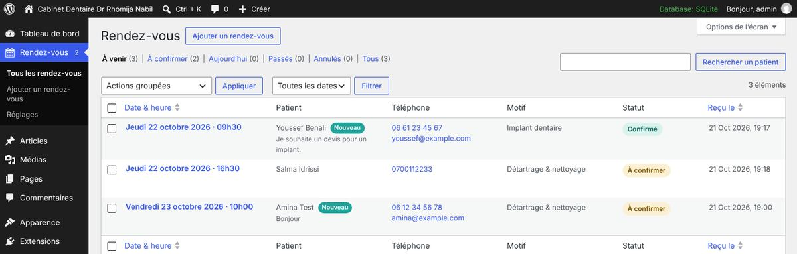

# Cabinet Dentaire Dr Rhomija Nabil: website rebuild

A rebuild of the clinic's WordPress site (`lavender-chamois-170103.hostingersite.com`), focused on two jobs:
**getting patients to book**, and **getting found on Google** by people searching for a dentist in Témara.

| Desktop | Mobile |
| --- | --- |
|  |  |

The site is in French and runs on the existing WordPress install, so the clinic keeps its hosting, its plugins and its admin.
**The whole site is in French:** pages, booking form, e-mails, admin screens, and `lang="fr-FR"`.
There is **no team or staff section**: the only person named is Dr Rhomija Nabil, as part of the clinic's name, as on the wall sign.
It consists of two pieces:

| Folder | What it is |
| --- | --- |
| `wordpress/plugins/rhomija-booking/` | **Booking plugin.** Shows the clinic's free slots in real time. It records booking requests, emails the clinic and the patient, and gives the clinic a WordPress screen to confirm or cancel (by e-mail or WhatsApp). |
| `wordpress/themes/rhomija/` | **Custom theme.** A fast, mobile-first theme with no page builder. It has a page per treatment for local SEO, the clinic's real photos, and a one-click installer that creates all the pages and menus. |
| `brand/` | The new logo (SVG + PNG + favicons). |
| `dist/` | **Ready-to-upload zips.** Rebuild them with `sh tools/build.sh`. |
| `docs/` | Screenshots of the rebuilt site. |

---

## Why the logo was redone

The media library held four logos: three AI-generated variants (one spells "RHOMIJJA") and a clip-art wordmark.
None matched the clinic's real **wall sign**, the one patients see at reception: a blue/teal circle with a white tooth,
and "CABINET DENTAIRE / DR. RHOMIJA NABIL" in a geometric typeface.

The new logo is a clean vector redraw of that sign: same circle, same blue (`#1C6DB5`) and teal (`#1FA39A`), same name layout.
The website, the sign and the e-mails now share one identity.



Files in `brand/`:
- `logo-horizontal.svg`: header
- `logo-horizontal-white.svg`: dark backgrounds
- `logo-stacked.svg`: square formats such as social profiles
- `logo-mark.svg`: icon only
- `png/`: PNG exports at several sizes

The small "CABINET DENTAIRE" line uses a darker teal (`#0F766E`), so it stays readable at header size (5.5:1 on white). The emblem keeps the sign's teal.
Text is converted to outlines, so the files render the same everywhere.
To regenerate them, run `tools/build_logo.py` with the Montserrat SemiBold and Bold TTF files.

---

## Install on the Hostinger WordPress (about 10 minutes)

> Nothing below deletes content. The current Toothwise theme stays installed, so rolling back is one click
> (Apparence → Thèmes → Toothwise → Activer).

1. *(Recommended)* Take a backup: hPanel → Sites web → Sauvegardes.
2. **Extensions → Ajouter → Téléverser une extension** → `dist/rhomija-booking.zip` → *Installer* → *Activer*.
3. **Apparence → Thèmes → Ajouter → Téléverser un thème** → `dist/rhomija-theme.zip` → *Installer* → *Activer*.
4. **Apparence → Installation du site → « Installer le site ».** This creates:
   - **Pages:** Accueil, Nos soins plus 9 treatment pages, Le cabinet, Prendre rendez-vous, Contact & accès, Conseils dentaires, Mentions légales & confidentialité
   - **3 advice articles**
   - **Menus:** main menu and footer menu
   - **Settings:** static home page, title *Cabinet Dentaire Dr Rhomija Nabil* (replaces "Rhoija Smile"), Morocco time zone, site language French (`fr_FR`)

   Pages that already exist are never overwritten, so the installer is safe to run again.
5. **Rendez-vous → Réglages:** check the phone number, **add the WhatsApp number**, and set opening hours and closed days (holidays, leave).
6. **Apparence → Personnaliser → « Cabinet : textes & liens »:** paste the Google Maps share link, the "leave a Google review" link, and the Facebook and Instagram links.
7. **LiteSpeed Cache → Purger tout.**
8. Make a test booking from a phone, check the e-mail arrives at `cabinetrhomija@gmail.com`, then confirm or cancel it from **Rendez-vous**.

Clinic details (phone, WhatsApp, e-mail, address, hours) are edited **in one place** (Rendez-vous → Réglages) and update everywhere:
header, footer, contact page, booking e-mails and Google structured data.

---

## Deployment log: live site, 21 October 2026

Deployed to `https://lavender-chamois-170103.hostingersite.com` with the admin account:

| Change | Before | After |
| --- | --- | --- |
| Plugin | none | **Rhomija — Prise de rendez-vous** 1.0.0 (active) |
| Theme | Toothwise (still installed) | **Rhomija Dentaire** 1.0.0 |
| Site title / tagline | "Rhoija Smile" / empty | "Cabinet Dentaire Dr Rhomija Nabil" / "Dentiste à Témara — soins, esthétique, implants et urgences" |
| Home page | theme's latest-posts template | static page **Accueil**; posts page **Conseils dentaires** |
| Time zone | UTC+0 | Africa/Casablanca |
| Language | fr_FR | fr_FR (unchanged) |
| Pages / articles / menus | none published | 16 pages, 3 articles, "Menu principal", "Pied de page" |
| Privacy page | draft "Privacy Policy" | "Mentions légales & confidentialité" |
| Site logo | old clip-art logo (media #19) | none: the theme shows its bundled new SVG logo |
| Site icon | old cropped logo (media #20) | new tooth icon (media #74) |
| Sample post "Hello world!" | published | moved to the trash (recoverable) |
| LiteSpeed cache | — | purged |

**To roll back:**
1. Apparence → Thèmes → Toothwise → Activer.
2. Optionally restore the old logo and icon in Personnaliser → Identité du site.
3. Optionally put back the old title in Réglages → Général.

Nothing was deleted, so the old theme, media and drafts are all still there.

---

## Connecting the domain `dentiste-rhomija.ma`

**Status on 21 October 2026:** the domain is registered, but its DNS is still at the registrar:
- Nameservers: `ns1–ns4.hostino.com`
- Address: `88.198.27.55`, which serves an empty placeholder page

It does not point to Hostinger yet. Steps to connect it:

1. **In hPanel:** *Sites web* → the site `lavender-chamois-170103.hostingersite.com` → **Connecter / changer de domaine** → `dentiste-rhomija.ma`.
   Hostinger switches the WordPress address from the temporary domain to the new one.
2. **At the registrar** (where the domain was bought), do either of the following:
   - **Recommended:** replace the nameservers with the ones hPanel shows for this site (normally `ns1.dns-parking.com` and `ns2.dns-parking.com`).
   - **Or:** keep the registrar's DNS and set the `A` records for `@` and `www` to the IP address hPanel shows, removing `88.198.27.55`.

   Changes to `.ma` domains can take a few hours.
3. **SSL:** hPanel → *Sécurité → SSL* → install the free certificate for `dentiste-rhomija.ma`, then enable *Forcer HTTPS*.
4. **Check the address:** in WordPress → *Réglages → Général*, make sure both addresses are `https://dentiste-rhomija.ma`.
5. **Finish up:**
   - LiteSpeed Cache → *Purger tout*.
   - Reconnect Site Kit, so Analytics follows the new domain.
   - Add `dentiste-rhomija.ma` in Google Search Console and submit `https://dentiste-rhomija.ma/sitemap.xml` (generated by All in One SEO).

The theme and the installed content contain **no hard-coded address**: links, images, structured data and e-mails all follow the site address.
This was verified by switching a test install to a new address and checking that no page still referenced the old one.

---

## How booking works

**For the patient:**
1. Pick a reason for the visit, then a day and a free time slot (only real free slots are shown).
2. Enter name, phone and, optionally, an e-mail.
3. Submit. On the success screen they can add the appointment to their calendar or ping the clinic on WhatsApp.

Treatment pages link to the form with that treatment already selected.



**For the clinic** (WordPress → **Rendez-vous**):
- **Views:** *À venir*, *À confirmer* (also shown as a counter on the menu), *Aujourd'hui*, *Passés*, *Annulés*.
- **One-click actions:** **Confirmer** · **Honoré** · **Annuler** · **WhatsApp** (opens WhatsApp with a pre-written confirmation).
- **Confirmation e-mail:** confirming sends the patient an e-mail with a calendar invite (`.ics`), if they gave an address.
- **Phone bookings:** add them with *Ajouter un rendez-vous*. They block the slot like online ones.
- **Dashboard:** a *Prochains rendez-vous* widget is pinned at the top.
- **Search:** finds patients by name, phone or e-mail.



**Rules** (in Réglages):
- Slot length: 30 minutes by default.
- Patients per slot: 1.
- Minimum notice: 2 hours.
- Booking window: 60 days ahead.
- Closed dates: one per line.

**Protection:**
- Honeypot field, a minimum time to fill the form, and a rate limit per visitor.
- Slot availability is re-checked at submit time.
- One active request per phone number per day.
- The booking API sends no-cache headers, so Hostinger's LiteSpeed cache can't serve stale availability.

**Consent:** the form asks for consent under **loi 09-08** and links to the privacy page.

---

## Marketing and SEO built in

- **Treatment pages:** 9 pages with real, careful copy (consultation, scaling, cavities and root canals, extractions, implants, prostheses, aesthetics and whitening, children, emergencies). They target searches like "implant dentaire Témara".
- **Structured data:** schema.org `Dentist` data on every page, with address, phone, opening hours, treatments, a booking action and areas served.
- **Meta tags:** meta description and Open Graph sharing image (`assets/img/partage-social.jpg`). When All in One SEO is active (it is on the live site), it keeps control of these and the theme only supplies defaults.
- **Content marketing:** 3 starter articles. Add more under *Articles* with the category *Conseils dentaires*.
- **Conversion features:**
  - Next free slot shown in the hero.
  - Sticky mobile bar (Appeler / WhatsApp / Rendez-vous).
  - Click-to-call everywhere.
  - Booking form embedded on the home page.
- **Analytics events** work with Google Site Kit (already installed), GTM and the Meta Pixel. In GA4, mark `generate_lead` as a key event:
  - `generate_lead` (booking sent)
  - `click_call`
  - `click_whatsapp`
  - `click_directions`
  - `click_booking`
  - `click_review`
- **Speed:**
  - No jQuery and no page builder on the front end.
  - Self-hosted fonts.
  - WebP photos (about 330 KB for all five clinic photos at full size, about 125 KB for the mobile versions).
  - About 76 KB of HTML on the home page, with 2 scripts and 2 stylesheets.
- **Accessibility:**
  - **Text contrast meets WCAG AA (at least 4.5:1) everywhere.** This was checked with the axe-core tool on every page (desktop and mobile), every booking step, the mobile menu, the four e-mail types and the admin list.
  - Text over gradients was checked by hand at its worst point.
  - Skip link, keyboard-usable menus and booking calendar, ARIA state on slots, visible focus, and reduced-motion support.
  - `color-scheme: light`, so phones in forced dark mode don't recolour the text.

---

## To confirm with Dr Rhomija before going live

I wrote the copy from the existing site, the clinic photos and a public directory listing. A few things need the doctor's confirmation:

- [ ] **WhatsApp number.** Not found anywhere. Until it is entered, the WhatsApp buttons are hidden.
- [ ] **Opening hours.** The current site says *Lun–Samedi 9:00–17:00*. Is there a lunch break, or a shorter Saturday?
- [ ] **Treatments offered.** Confirm implants, prostheses, whitening and veneers, and children's care. Delete a page if a treatment isn't offered. Orthodontics was left out on purpose; add it if offered.
- [ ] **Claims made on the site:**
  - On-site panoramic X-ray (visible in the photos)
  - Dedicated sterilisation room (visible in the photos)
  - Written quote before major treatment
  - Reimbursement paperwork (AMO / mutuelle)
  - Emergencies seen as quickly as possible
- [ ] **Exact Google Maps pin.** Paste the share link in Personnaliser. The embedded map currently uses an address search.
- [ ] **CNDP.** Online booking processes health-related personal data. Check the clinic's CNDP declaration or authorisation under loi 09-08 and add its number to *Mentions légales & confidentialité*.
- [ ] Delete WordPress's sample post *Bonjour tout le monde !* and sample page if they exist.

---

## What I could and couldn't access

- **Hostinger AI Builder (first site):** the login page is behind a Cloudflare bot check, so I couldn't open that project.
  The rebuild is based on the WordPress site, the clinic's own photos (from the media library) and its public listing.
  If you export or publish the AI-builder version, its content can be merged in.
- **WordPress admin (second site):** after the password was reset and the account was made an administrator, the site was deployed (see *Deployment log*). Everything was built and tested on a local copy of WordPress 7.1.3, the same version as the live site.

---

## Development

```sh
sh tools/build.sh            # rebuild dist/*.zip
python3 tools/build_logo.py Montserrat-SemiBold.ttf Montserrat-Bold.ttf brand   # regenerate logos (needs fonttools, uharfbuzz, cairosvg)
```

- Theme text domain: `rhomija`. Plugin text domain: `rhomija-booking`. Requires PHP 7.4+ and WordPress 6.4+.
- WP-CLI: `wp rhomija install` runs the same installer as the admin button.
- **Booking REST API** (`/wp-json/rhomija-booking/v1/`):
  - `GET month?month=YYYY-MM`
  - `GET slots?date=YYYY-MM-DD`
  - `GET next`
  - `POST appointments`
- **Plugin hooks:** `rb_new_appointment` and `rb_status_changed`.
- **Tested locally:**
  - Fresh install from the zips; every page returns 200 with no PHP notices.
  - Full booking flow on mobile and desktop, plus the validation, double-booking, spam and closed-day cases.
  - Admin confirm action, and the three e-mails it triggers.
  - Theme works with the plugin deactivated; the booking page then shows the phone number instead.
